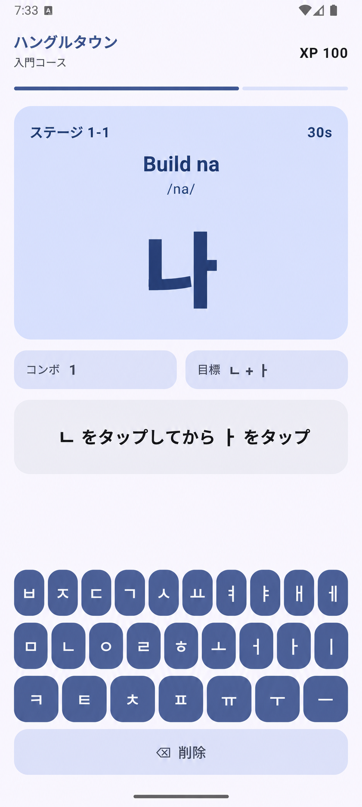
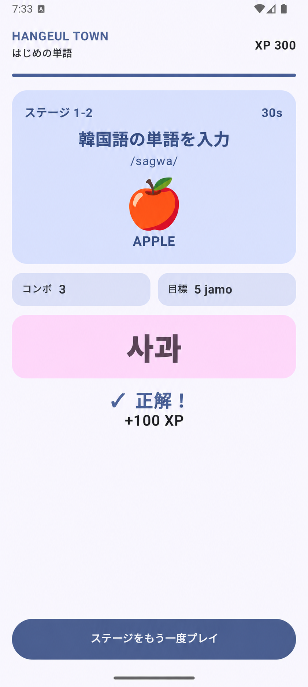

# Hangeul Town

[日本語](README.ja.md) · [English](README.md) · [한국어](README.ko.md)

Hangeul Townは、外国人学習者がハングルが組み立てられる原理をゲームのように学び、実際の韓国語タイピングまで練習できるようにしたスマートフォンAndroidアプリです。

## スクリーンショット

<p>
  
  
</p>

## コア機能

- 文字入力に応じて文字がリアルタイムで組み立てられるハングル組み合わせシステム
- 二重構造をベースにしたアプリ内ハングルキーボード
- 字母が合わされ音節と単語になるマージアニメーション
- 絵文字、英語の意味、ローマ字の発音ヒントを活用した初級単語チャレンジ
- XP、コンボ、ステージクリア報酬
- Android TextToSpeechベースの韓国語の発音を再生

## 現在プレイ可能なステージ

現在の最初のプレイヤーブルバージョンでは、次の文字と単語を学習します。

- 秋
- 私
- りんご
- ミルク
- コーヒー
- バナナ

ステージを最後まで完了すると、現在の基準950 XPと6コンボに到達します。

## 技術スタック

- Kotlin
- Jetpack Compose
- Material 3
- Android ViewModelとStateFlow
- Android TextToSpeech

## ビルド

```powershell
.\gradlew.bat testDebugUnitTest assembleDebug
```

スマートフォンエミュレータでAndroid接続テストを実行するには、次のコマンドを使用します。

```powershell
.\gradlew.bat connectedDebugAndroidTest
```
