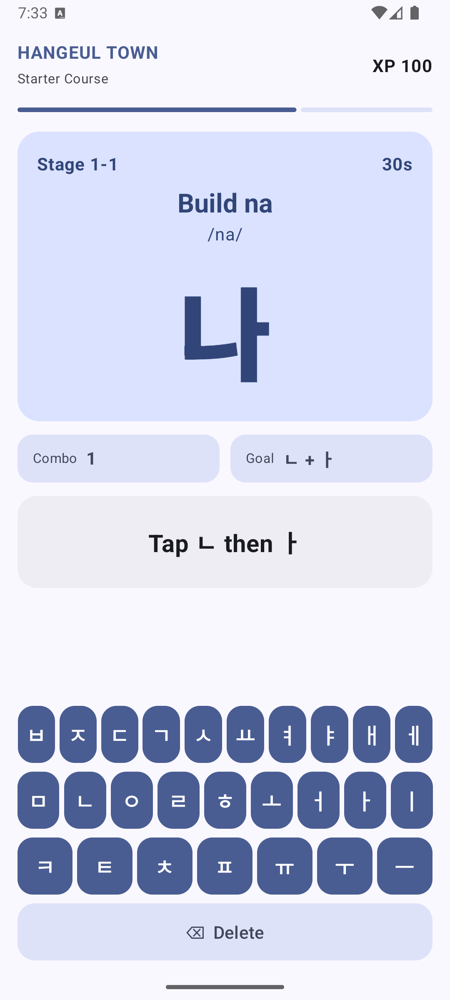
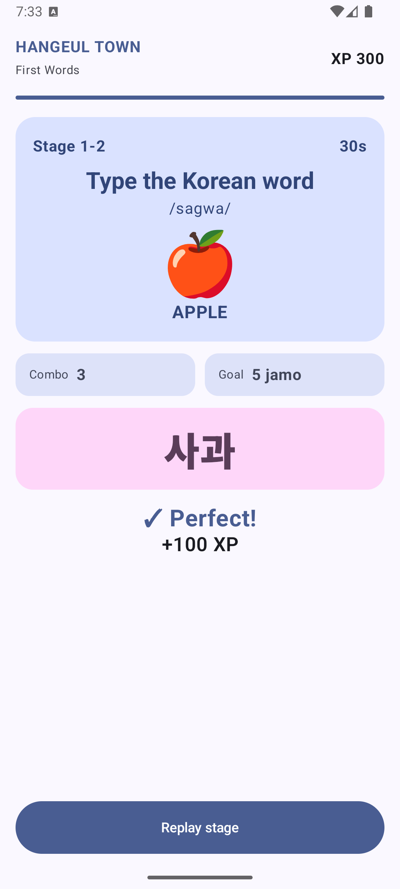

# Hangeul Town

[日本語](https://github.com/hjy0221/HangeulTown#%E6%97%A5%E6%9C%AC%E8%AA%9E) · [English](https://github.com/hjy0221/HangeulTown#english) · [한국어](https://github.com/hjy0221/HangeulTown#%ED%95%9C%EA%B5%AD%EC%96%B4)

## 日本語

Hangeul Town は、ハングルの組み立てをゲーム感覚で学び、韓国語のタイピングを練習できる Android スマートフォンアプリです。

### 機能

- 子音と母音から文字をリアルタイムに組み立てる、2ボル式のアプリ内キーボード
- 字母を音節・単語にまとめるアニメーション
- 絵文字、英語の意味、ローマ字のヒントを使う初級単語チャレンジ
- XP、コンボ、ステージ報酬、Android TextToSpeech による韓国語の発音

最初のプレイ可能版では 가、나、사과、우유、커피、바나나 を学びます。全ステージを完了すると現在は 950 XP と6コンボに到達します。スクリーンショットは韓国語セクションにあります。

### 技術とビルド

Kotlin、Jetpack Compose、Material 3、Android ViewModel、StateFlow、Android TextToSpeech を使用します。

```powershell
.\gradlew.bat testDebugUnitTest assembleDebug
```

スマートフォンエミュレーターで接続テストを実行するには:

```powershell
.\gradlew.bat connectedDebugAndroidTest
```

## English

Hangeul Town is an Android phone app for learners of Korean to explore how Hangul letters are assembled through game-like challenges and practice typing Korean.

### Features

- Real-time Hangul composition from individual consonants and vowels, using an in-app keyboard based on the two-set layout.
- Merge animations that combine letters into syllables and words.
- Beginner word challenges with emoji, English meanings, and romanization hints.
- XP, combos, stage rewards, and Korean pronunciation via Android TextToSpeech.

The first playable version covers 가, 나, 사과 (apple), 우유 (milk), 커피 (coffee), and 바나나 (banana). Completing all stages currently yields 950 XP and a six-hit combo. Screenshots are shown above.

### Technology and build

The app uses Kotlin, Jetpack Compose, Material 3, Android ViewModel and StateFlow, and Android TextToSpeech.

```powershell
.\gradlew.bat testDebugUnitTest assembleDebug
```

To run connected Android tests on a phone emulator:

```powershell
.\gradlew.bat connectedDebugAndroidTest
```

## 한국어

Hangeul Town은 외국인 학습자가 한글이 조립되는 원리를 게임처럼 배우고, 실제 한국어 타이핑까지 연습할 수 있도록 만든 스마트폰 Android 앱입니다.

## 스크린샷

<p>
  
  
</p>

## 핵심 기능

- 자모 입력에 따라 글자가 실시간으로 조립되는 한글 조합 시스템
- 두벌식 구조를 바탕으로 한 앱 내부 한글 키보드
- 자모가 합쳐져 음절과 단어가 되는 머지 애니메이션
- 이모지, 영어 뜻, 로마자 발음 힌트를 활용한 초급 단어 챌린지
- XP, 콤보, 스테이지 클리어 보상
- Android TextToSpeech 기반 한국어 발음 재생

## 현재 플레이 가능한 스테이지

현재 첫 플레이어블 버전에서는 다음 글자와 단어를 학습합니다.

- 가
- 나
- 사과
- 우유
- 커피
- 바나나

스테이지를 끝까지 완료하면 현재 기준 950 XP와 6 콤보에 도달합니다.

## 기술 스택

- Kotlin
- Jetpack Compose
- Material 3
- Android ViewModel과 StateFlow
- Android TextToSpeech

## 빌드

```powershell
.\gradlew.bat testDebugUnitTest assembleDebug
```

스마트폰 에뮬레이터에서 Android 연결 테스트를 실행하려면 다음 명령을 사용합니다.

```powershell
.\gradlew.bat connectedDebugAndroidTest
```
