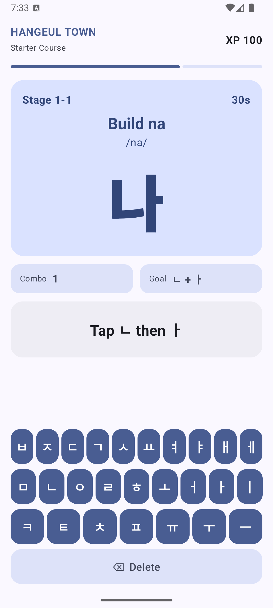
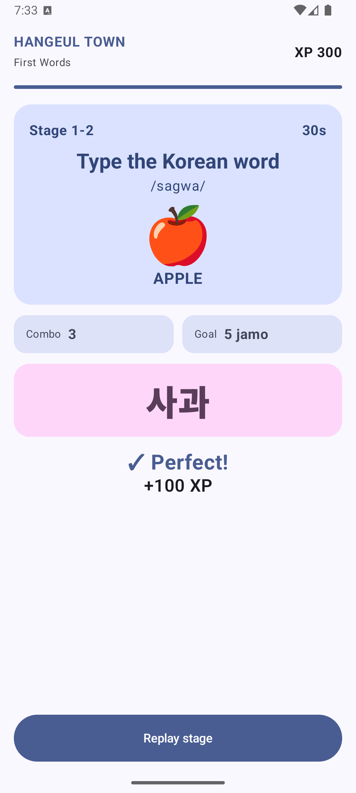

# Hangeul Town

[日本語](https://github.com/hjy0221/HangeulTown#%E6%97%A5%E6%9C%AC%E8%AA%9E) · [English](https://github.com/hjy0221/HangeulTown#english) · [한국어](https://github.com/hjy0221/HangeulTown#%ED%95%9C%EA%B5%AD%EC%96%B4)

## 日本語

Hangeul Townは、外国人学習者がハングルが組み立てられる原理をゲームのように学び、実際の韓国語タイピングまで練習できるようにしたスマートフォンAndroidアプリです。

## スクリーンショット

<p>
  
  
</p>

## コア機能

- 文字入力に応じて文字がリアルタイムで組み立てられるハングル組み合わせシステム
- 二重構造をベースにしたアプリ内ハングルキーボード
- 字母が合わされ音節と単語になるマージアニメーション
- 絵文字、英語の意味、ローマ字の発音ヒントを活用した初級単語チャレンジ
- XP、コンボ、ステージクリア報酬
- Android TextToSpeechベースの韓国語の発音を再生

## 現在プレイ可能なステージ

現在の最初のプレイヤーブルバージョンでは、次の文字と単語を学習します。

- 秋
- 私
- りんご
- ミルク
- コーヒー
- バナナ

ステージを最後まで完了すると、現在の基準950 XPと6コンボに到達します。

## 技術スタック

- Kotlin
- Jetpack Compose
- Material 3
- Android ViewModelとStateFlow
- Android TextToSpeech

## ビルド

```powershell
.\gradlew.bat testDebugUnitTest assembleDebug
```

スマートフォンエミュレータでAndroid接続テストを実行するには、次のコマンドを使用します。

```powershell
.\gradlew.bat connectedDebugAndroidTest
```

## English

Hangeul Town is a smartphone Android app that allows foreign learners to learn how the Korean alphabet is assembled in a game-like manner and even practice actual Korean typing.

## Screenshot

<p>
  
  
</p>

## Core features

- Hangul combination system that assembles letters in real time according to alphabet input
- Korean keyboard inside the app based on a two-set structure
- Merge animation where letters are combined to form syllables and words
- Beginner word challenge using emojis, English meanings, and Roman alphabet pronunciation hints
- XP, combo, stage clear rewards
- Korean pronunciation playback based on Android TextToSpeech

## Currently playable stages

Currently in the first playable version, you learn the following letters and words:

- Go
- me
- apple
- milk
- coffee
- Banana

Completing the stage to the end will currently net you 950 XP and 6 combos.

## Technology Stack

- Kotlin
- Jetpack Compose
-Material 3
- Android ViewModel and StateFlow
-Android TextToSpeech

## Build

```powershell
.\gradlew.bat testDebugUnitTest assembleDebug
```

To run the Android connectivity test on a smartphone emulator, use the following command:

```powershell
.\gradlew.bat connectedDebugAndroidTest
```

## 한국어

Hangeul Town은 외국인 학습자가 한글이 조립되는 원리를 게임처럼 배우고, 실제 한국어 타이핑까지 연습할 수 있도록 만든 스마트폰 Android 앱입니다.

## 스크린샷

<p>
  
  
</p>

## 핵심 기능

- 자모 입력에 따라 글자가 실시간으로 조립되는 한글 조합 시스템
- 두벌식 구조를 바탕으로 한 앱 내부 한글 키보드
- 자모가 합쳐져 음절과 단어가 되는 머지 애니메이션
- 이모지, 영어 뜻, 로마자 발음 힌트를 활용한 초급 단어 챌린지
- XP, 콤보, 스테이지 클리어 보상
- Android TextToSpeech 기반 한국어 발음 재생

## 현재 플레이 가능한 스테이지

현재 첫 플레이어블 버전에서는 다음 글자와 단어를 학습합니다.

- 가
- 나
- 사과
- 우유
- 커피
- 바나나

스테이지를 끝까지 완료하면 현재 기준 950 XP와 6 콤보에 도달합니다.

## 기술 스택

- Kotlin
- Jetpack Compose
- Material 3
- Android ViewModel과 StateFlow
- Android TextToSpeech

## 빌드

```powershell
.\gradlew.bat testDebugUnitTest assembleDebug
```

스마트폰 에뮬레이터에서 Android 연결 테스트를 실행하려면 다음 명령을 사용합니다.

```powershell
.\gradlew.bat connectedDebugAndroidTest
```
